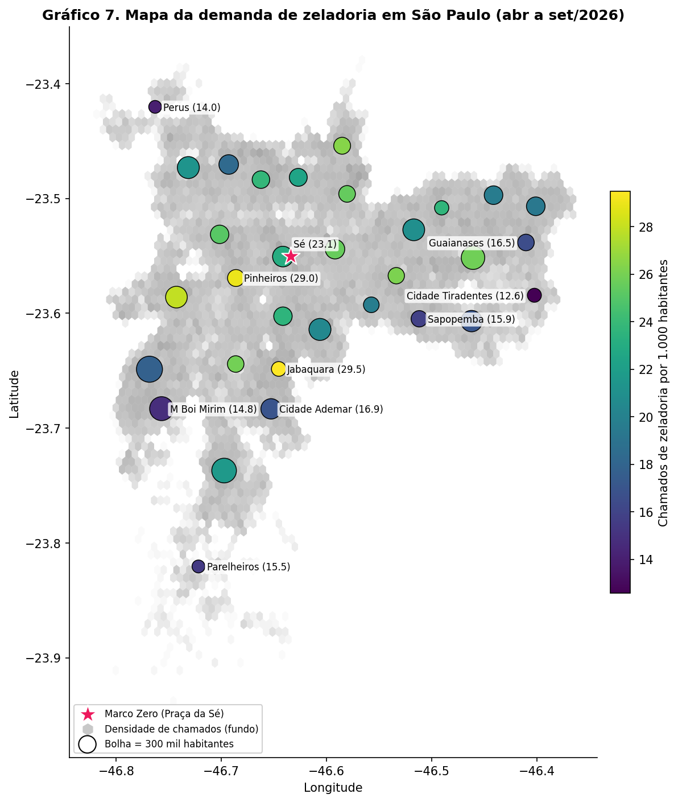
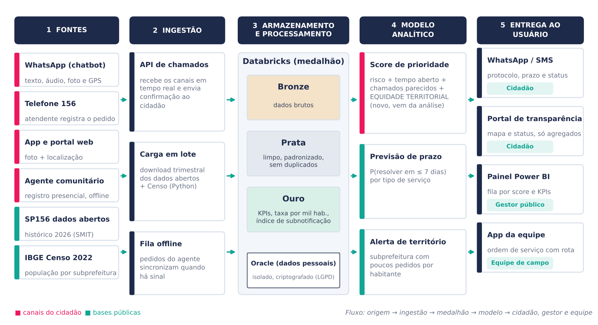
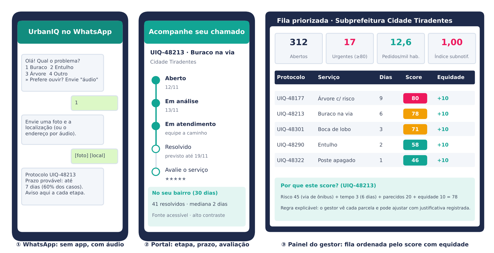
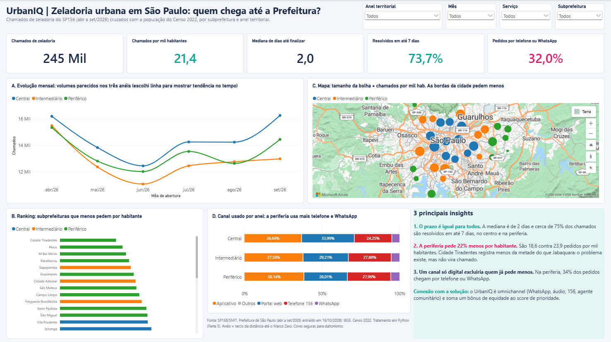

<div align="center">

<picture>
  <source media="(prefers-color-scheme: dark)" srcset="../docs/assets/logo-urbaniq-transparente-escuro.png">
  
</picture>

### Global Solution 2026.2 | CitizenTech

*Data Science, inovação e tecnologia colocando o cidadão no centro da inovação*


[](https://youtu.be/WETcig7gwHQ)

</div>

---

## O achado que mudou o projeto

Comecei com uma hipótese: **na periferia de São Paulo, a Prefeitura demora mais para resolver os problemas de zeladoria.** Para testar, analisei **245 mil pedidos reais do SP156** (abril a setembro de 2026) cruzados com a **população do Censo 2022**.

Os dados mostraram outra coisa:

| Hipótese | Resultado | Evidência |
|---|---|---|
| **H1**: a periferia espera mais | Não sustentada | Mediana de 2 dias em todos os anéis; Mann-Whitney com p = 1,0 |
| **H2**: a periferia pede menos | **Sustentada** | 18,6 contra 23,9 pedidos por mil habitantes (−22%); Spearman ρ = −0,61 (p = 0,0002) |
| **H3**: a periferia usa mais canais não digitais | Sustentada | Telefone 156 e WhatsApp: 34% na periferia; qui-quadrado significativo |

> **O problema não é a Prefeitura atender pior a periferia. É a periferia chegar menos até a Prefeitura.**

<div align="center">

<br><em>Mapa da demanda: as bolhas escuras, nas bordas da cidade, são as subprefeituras que menos pedem por habitante.</em>
</div>

---

## A solução: UrbanIQ como CitizenTech

- **Porta de entrada inclusiva:** WhatsApp com menu numérico e áudio, telefone 156, aplicativo e agentes comunitários com registro offline.
- **Score de prioridade com equidade:** risco + tempo em aberto + reiterações + bônus para os territórios que pedem pouco.
- **Prazo realista:** o cidadão recebe, na abertura, a probabilidade de resolução em 7 dias para aquele serviço.
- **Transparência:** status a cada etapa e portal público só com dados agregados (LGPD).

**ODS:** 10 (Redução das desigualdades), 11 (Cidades e comunidades sustentáveis) e 16 (Instituições eficazes).

### Arquitetura



### Protótipo de baixa fidelidade



### Painel Power BI



---

## Entregáveis

| Parte | Arquivo |
|---|---|
| 1. Proposta executiva (PDF) | [`entregaveis/GS_1TSCOB_Pitch_UrbanIQ_DataGuy.pdf`](entregaveis/GS_1TSCOB_Pitch_UrbanIQ_DataGuy.pdf) |
| 2. Vídeo pitch (4min51) | [youtu.be/WETcig7gwHQ](https://youtu.be/WETcig7gwHQ) |
| 3. Análise de dados em Python | [`entregaveis/parte3/GS_1TSCOB_Dados_UrbanIQ_DataGuy.ipynb`](entregaveis/parte3/GS_1TSCOB_Dados_UrbanIQ_DataGuy.ipynb) |
| Painel de BI (arquivo fonte) | [`painel-bi/GS_1TSCOB_Painel_UrbanIQ_DataGuy.pbix`](painel-bi/GS_1TSCOB_Painel_UrbanIQ_DataGuy.pbix) |

### Técnicas aplicadas no notebook

Pandas, NumPy e Matplotlib · limpeza e normalização (datas em dois formatos, padronização de subprefeituras, remoção de reiterações, taxa por mil habitantes) · estatística descritiva · **integração de dados** (SP156 + Censo) · **testes de hipóteses** (Mann-Whitney e qui-quadrado) · **correlação** (Spearman) · **probabilidade** (P de resolução em até 7 dias) · mapa com densidade de chamados.

---

## Como reproduzir

1. Baixe as bases do SP156 (2º e 3º trimestres de 2026) em [dados.prefeitura.sp.gov.br/dataset/dados-do-sp156](http://dados.prefeitura.sp.gov.br/dataset/dados-do-sp156) e salve em `entregaveis/parte3/dados/` com os nomes `arquivo-final-2-trim-26.csv` e `arquivo-final-3-trim-26.csv`. Elas não vão para o GitHub porque passam do limite de 100 MB.
2. Instale as dependências: `pip install pandas numpy matplotlib scipy jupyter`.
3. Abra `entregaveis/parte3/GS_1TSCOB_Dados_UrbanIQ_DataGuy.ipynb` e execute do início ao fim. Todos os caminhos são relativos.

## Estrutura da pasta

```
gs-citizentech/
├── entregaveis/        # PDF final, notebook executado (parte3/) e ZIP de entrega
├── painel-bi/          # Painel Power BI (.pbix e projeto .pbip) + script do layout
├── pitch/              # Slides (.pptx), scripts das figuras, roteiro e logos
├── notebook/           # Script que gera o notebook (build_nb.py)
├── dados/raw/          # População por subprefeitura (Censo 2022)
└── docs/               # Imagens usadas neste README
```

## Fontes de dados

- **SP156: Solicitações** | SMIT, Prefeitura de São Paulo (dados abertos, anonimizados na origem)
- **População por subprefeitura, Censo 2022** | IBGE, agregado pela Prefeitura de São Paulo

---

<div align="center">

**Thiago Fiel de Oliveira** · RM 570088 · Tecnólogo em Ciência de Dados, FIAP

*O UrbanIQ não conserta a rua, mas garante que toda rua seja ouvida.*

</div>
